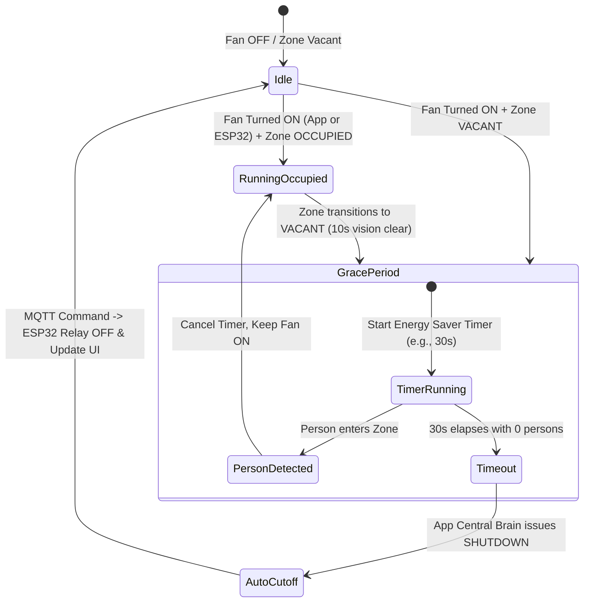
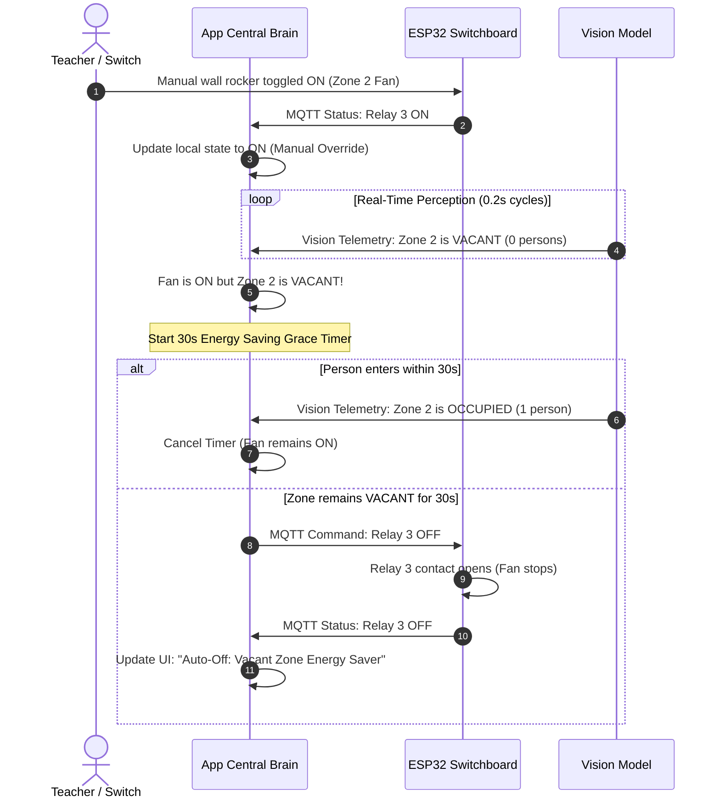

# ClassPulse IoT: Autonomous University Classroom Management System
> **Closed-Loop Cyber-Physical Automation with Tri-State Synchronization & Vision-Driven Occupancy Optimization**

---

## 1. Executive System Overview

**ClassPulse IoT** is a distributed, closed-loop classroom management and energy-saving platform developed for university campuses. It unifies mobile app management, edge microcontroller switching, and edge computer vision into an integrated Cyber-Physical System (CPS).

In this system, the **ClassPulse Flutter App serves as the Central Brain Hub**, arbitrating commands, maintaining ground-truth state, coordinating physical switchboards, and making real-time autonomous decisions based on computer vision occupancy evidence.

```
┌──────────────────────────────────────────────────────────────────────────────────┐
│                             CENTRAL BRAIN HUB (APP)                              │
│                           ClassPulse Flutter Platform                            │
│   • Global Room & Zone Topology        • Tri-State Reconciliation Engine         │
│   • Energy Saving Automation Rules     • Real-time Telemetry & Cloud Firestore   │
└───────────────────────▲──────────────────────────────────▲───────────────────────┘
                        │                                  │
          MQTT (QoS 0/1)│Actuation & Telemetry             │MQTT (QoS 0)
                        │                                  │Physical State & Occupancy
┌───────────────────────▼──────────────┐   ┌───────────────┴───────────────────────┐
│       EDGE HARDWARE ACTUATOR         │   │        EDGE VISION SENTINEL           │
│      ESP32 DevKit Switchboards       │   │    Raspberry Pi + Camera Module       │
│ • 4-Channel Relays (GPIO 18,19,21,22)│   │ • SSD MobileNetV2 Person Detector     │
│ • Optical Gree IR AC (GPIO 4)        │   │ • Polygon Seating-Zone Demarcation    │
│ • Local Switchboard Wall Rockers     │   │ • Appliance Physical State Perception │
└──────────────────────────────────────┘   └───────────────────────────────────────┘
```

### The Closed-Loop Paradigm
* **Open-Loop (Legacy):** The app issues a toggle command $\rightarrow$ ESP32 energizes a relay $\rightarrow$ The app assumes the appliance is on. There is zero awareness of whether the luminaire is actually illuminated, whether the fan motor is spinning, or whether anyone is present in the room.
* **Closed-Loop (ClassPulse 3-Way Synchronization):**
  1. **User Intent State:** Desired state initiated via App UI, timetable schedule, or manual wall rocker.
  2. **Electrical Relay State:** ESP32 energizes relay and returns microsecond contact telemetry.
  3. **Verified Physical State:** Ceiling-mounted Vision Model confirms actual room conditions (light illuminated, fan blades rotating, and presence of human occupants per zone).
  4. **State Reconciliation & Energy Savings:** If a zone is unoccupied, the Central Brain automatically switches off appliances in that zone. If a relay is energized but the appliance does not respond, a hardware fault is flagged.

---

## 2. Hardware Topology & Zone Architecture

Classrooms are partitioned into distinct **Zones**. Each Zone corresponds to a designated seating area and its corresponding physical electrical switchboard.

### Zone-to-Switchboard Mapping
* **1 Zone $\equiv$ 1 Physical Switchboard $\equiv$ 1 ESP32 Controller** (`BOARD_ID` = `ZONE_ID`).
* Switchboards are addressed independently over MQTT topics, preventing cross-talk between zones and rooms.

```
Classroom (e.g., rcb_room_304)
 ├── Zone 1 (Switchboard #1, ESP32)
 │    ├── Relay 1 (GPIO 18): Light 1
 │    ├── Relay 2 (GPIO 19): Light 2
 │    ├── Relay 3 (GPIO 21): Ceiling Fan 1
 │    ├── Relay 4 (GPIO 22): Ceiling Fan 2
 │    └── Optical IR (GPIO 4): Gree Air Conditioner (Bypasses Relays)
 ├── Zone 2 (Switchboard #2, ESP32)
 │    ├── Relay 1 (GPIO 18): Light 3
 │    ├── Relay 2 (GPIO 19): Light 4
 │    ├── Relay 3 (GPIO 21): Ceiling Fan 3
 │    ├── Relay 4 (GPIO 22): Ceiling Fan 4
 │    └── Optical IR (GPIO 4): Gree Air Conditioner
 └── Zone 3 (Switchboard #3, ESP32)
      └── ...
```

### Switchboard Channel Assignment (Per Zone)
| Appliance Type | Physical Channel | ESP32 GPIO | Operating Protocol | Control Mode |
| :--- | :--- | :--- | :--- | :--- |
| **Light 1** | Relay 1 | `GPIO 18` | Active LOW Relay | Digital ON/OFF |
| **Light 2** | Relay 2 | `GPIO 19` | Active LOW Relay | Digital ON/OFF (or PWM) |
| **Ceiling Fan 1** | Relay 3 | `GPIO 21` | Active LOW Relay | Multi-speed / ON/OFF |
| **Ceiling Fan 2** | Relay 4 | `GPIO 22` | Active LOW Relay | Multi-speed / ON/OFF |
| **Air Conditioner**| IR Transmitter | `GPIO 4` | Optical Gree IR | Relays Bypassed (38kHz) |

---

## 3. Tri-State Reconciliation & Closed-Loop Synchronization

In this architecture, every appliance has three distinct states tracked simultaneously by the Central Brain Hub:

```
                  ┌──────────────────────────────┐
                  │      1. User Intent State    │
                  │ (App UI / Timetable Schedule)│
                  └──────────────┬───────────────┘
                                 │ MQTT Command
                                 ▼
┌──────────────────────────────┐    Feedback     ┌──────────────────────────────┐
│  2. Electrical Relay State   │◄───────────────►│ 3. Verified Physical Reality │
│  (ESP32 Switchboard Hardware)│                 │ (Vision Model / AI Camera)   │
└──────────────────────────────┘                 └──────────────────────────────┘
```

### Tri-State Truth Table & Reconciliation Matrix

| Intent State (App) | Hardware Relay (ESP32) | Physical Reality (Vision Model) | System Diagnosis & Brain Action | UI Status Indicator |
| :--- | :--- | :--- | :--- | :--- |
| **ON** | **ON** | **ON** (Illuminated / Spinning) | **Normal Operation:** Closed loop confirmed. All states aligned. | Solid Cyan / Green ("Verified Active") |
| **ON** | **ON** | **TRANSIT** ($< 5\text{s}$) | **Starting Up:** Appliance motor/filament accelerating. | Pulsing Cyan ("Engaging...") |
| **ON** | **ON** | **OFF** ($> 5\text{s}$) | **Hardware Fault:** Relay energized but no physical effect (bulb fused, fan capacitor blown, breaker tripped). | Blinking Amber / Red ("Hardware Fault Alert") |
| **OFF** | **OFF** | **OFF** | **Normal Idle:** Standby mode. | Slate Grey ("Standby") |
| **OFF** | **ON** | **ON** | **Manual Override:** Wall rocker switch flipped manually at ESP32. App adopts state to ON, checks occupancy. | Amber Outline ("Manual Switch Active") |
| **ON** / **OFF** | **ANY** | **UNKNOWN** | **Sensor Occlusion / Stale:** Vision model camera blocked or offline. Fallback to hardware relay state; notify admin. | Warning Icon ("Vision Sensor Offline") |

---

## 4. Occupancy-Based Smart Automation Engine

The Central Brain Hub continuously evaluates human occupancy in each zone to prevent energy waste.



### Autonomous Energy Saver Sequence
1. **Detection & Debounce:**
   * The Vision Model debounces human presence: requires 3 consecutive zero detections over $\ge 10\,\text{s}$ before asserting a zone is `VACANT`.
2. **Grace Period (Anti-Flapping):**
   * When a fan is switched ON in an empty zone (e.g., a teacher enters the room and flips the switch before sitting down), the App Central Brain starts an **Energy Saving Grace Period** (configurable: $30 - 60\,\text{s}$).
3. **Automated Cutoff:**
   * If the zone remains `VACANT` after the grace period:
     1. `ClassroomState` issues a high-priority shut-off: `MqttService.publishDeviceCommand(device, false)`.
     2. ESP32 cuts off Relay 3/4.
     3. App logs event: `"Auto-Off: Fan turned off due to zone vacancy"`.
     4. App displays a toast/notification: *"Zone [X] Fan auto-switched off to conserve energy."*



---

## 5. Unified MQTT Communication Specification

All nodes communicate via an isolated MQTT hierarchy scoped by campus building and room ID (e.g., `ruet/classroom/rcb_room_304/...`).

### A. App $\rightarrow$ ESP32 Actuator Commands
* **Topic:** `ruet/classroom/<ROOM_ID>/zone/<ZONE_ID>/relay/<RELAY_NUM>`
* **Payload:**
```json
{
  "room": "rcb_room_304",
  "zone": 1,
  "board": 1,
  "relay": 3,
  "state": "ON",
  "speed": 3,
  "gpio": 21,
  "type": "fan"
}
```

### B. ESP32 $\rightarrow$ App Hardware Feedback
* **Topic:** `ruet/classroom/<ROOM_ID>/zone/<ZONE_ID>/relay/<RELAY_NUM>/status`
* **Payload:**
```json
{
  "state": "ON",
  "relay": 3,
  "speed": 3,
  "gpio": 21,
  "uptime_ms": 142050
}
```

### C. Vision Model $\rightarrow$ App Real-Time Telemetry
* **Topic:** `ruet/classroom/<ROOM_ID>/vision/telemetry`
* **Payload:**
```json
{
  "schema_version": 2,
  "device_id": "rcb_304_pi_camera",
  "timestamp_unix_ms": 1792908000000,
  "zones": {
    "Zone 1": {
      "occupancy": "occupied",
      "person_count": 4,
      "appliances": {
        "lights": "illuminated",
        "fans": "spinning"
      }
    },
    "Zone 2": {
      "occupancy": "vacant",
      "person_count": 0,
      "appliances": {
        "lights": "dark",
        "fans": "spinning"
      }
    }
  }
}
```

### D. Heartbeat & Availability
* **ESP32 Heartbeat:** `ruet/classroom/<ROOM_ID>/status/board/<ZONE_ID>` (telemetry every 10s: IP, RSSI, status: `ONLINE`).
* **Vision Availability:** `ruet/classroom/<ROOM_ID>/vision/availability` (Retained Last Will and Testament: `online: true/false`).

---

## 6. Repository Structure

```
├── Classroom/                             # Flutter Mobile/Desktop/Web Application
│   ├── lib/
│   │   ├── models/                        # Data models (Classroom, ClassroomDevice)
│   │   ├── screens/                       # Dashboard, RoomControl, DeviceDetail
│   │   ├── services/                      # MqttService, FirestoreService
│   │   ├── state/                         # ClassroomState (Central Brain Hub)
│   │   └── widgets/                       # Custom Cyberpunk UI Components
│   └── esp32_firmware/                    # Arduino ESP32 Firmware
│       └── smart_classroom_switchboard_mqtt/
│           └── smart_classroom_switchboard_mqtt.ino
├── Vision_Model/                          # Edge Computer Vision System
│   ├── config/                            # Camera, model, and zone configuration
│   ├── docs/                              # Technical specifications and validation records
│   ├── models/                            # Quantized SSD MobileNetV2 COCO17 model
│   ├── sample_images/                     # Classroom test dataset
│   ├── scripts/                           # Environment setup and inspection scripts
│   └── src/                               # Camera capture, detector adapter, occupancy tracker
├── LICENSE                                # Open-source license
└── README.md                              # Central system architecture documentation
```

---

## 7. Deployment, Calibration & Setup Workflow

### Step 1: ESP32 Switchboard Commissioning
1. Open `Classroom/esp32_firmware/smart_classroom_switchboard_mqtt/smart_classroom_switchboard_mqtt.ino`.
2. Configure board constants:
   ```cpp
   #define ZONE_ID           1             // 1 for Switchboard 1, 2 for 2, etc.
   #define CLASSROOM_ID      "rcb_room_304"// Unique scoped Room ID
   #define WIFI_SSID         "YourSSID"
   #define WIFI_PASSWORD     "YourPassword"
   #define MQTT_BROKER       "broker.emqx.io"
   ```
3. Flash the firmware using the Arduino IDE with `ESP32 Dev Module` selected.
4. Verify serial monitor output: confirm Wi-Fi connection and MQTT subscription.

### Step 2: Vision Model Camera Calibration
1. Mount the Raspberry Pi Camera securely at the front ceiling facing the back rows.
2. Launch the calibration utility:
   ```powershell
   cd Vision_Model
   .\.venv\Scripts\python.exe -m src.calibrate_zones edit --image sample_images/IMG_20261013_133640.jpg --calibration config/zones.yaml
   ```
3. Define the bounding polygons for `Zone 1`, `Zone 2`, and `Zone 3` corresponding exactly to the seating groups wired to Switchboards 1, 2, and 3.
4. Set `calibrated: true` and start inference:
   ```bash
   python -m src.main run --config config/config.yaml
   ```

### Step 3: ClassPulse App Startup
1. Open the Flutter project in `Classroom/`:
   ```bash
   cd Classroom
   flutter pub get
   ```
2. Launch on Android/iOS/Web:
   ```bash
   flutter run -d chrome --web-renderer canvaskit
   ```
3. Authenticate as Admin or Teacher. The app connects to the MQTT broker, synchronizes room layouts from Cloud Firestore, ingests camera occupancy, and begins closed-loop operation.

---

## 8. Implementation Roadmap

- [x] **Architecture Planning & Protocol Specification** (Tri-state model, topic hierarchy, state reconciliation)
- [ ] **Phase 1: App Data Model & Vision Ingestion**
  - Add `isPhysicallyVerified` and `physicalState` fields to `ClassroomDevice`.
  - Subscribe to `ruet/classroom/+/vision/telemetry` in `MqttService`.
- [ ] **Phase 2: Central Brain Automation Engine**
  - Implement `onVisionTelemetryReceived` in `ClassroomState`.
  - Replace synthetic occupancy with genuine vision-driven room/zone occupancy.
  - Implement the **Occupancy-Based Energy Saver Timer** (auto-cutoff of fans in vacant zones).
- [ ] **Phase 3: Vision Model Output Adaptation**
  - Update `Vision_Model/src/mqtt_client.py` topic and JSON schema to emit `ruet/classroom/<ROOM_ID>/vision/telemetry`.
  - Implement optical frame differencing / luminance inspection for appliance states.
- [ ] **Phase 4: UI & Telemetry Indicators**
  - Add verified-state badges ("Verified Active" vs "Hardware Fault") in `RoomControlScreen`.
  - Add real-time zone occupancy chips to each zone card.

