# Phase 5 architecture and implementation boundary

The additive application is `python -m src.phase5_runtime`. Existing `src.main`,
SSD model/adapter, Picamera2 wrapper, calibration schema, occupancy tracker and
legacy MQTT publisher remain unchanged. Phase 5 defaults to OBSERVE with MQTT
disabled, no controller inventory and no authorized appliances.

The complete software pipeline exists. Raspberry Pi, CSI camera, real ESP32
firmware, wiring, physical calibration and appliance acceptance remain **PENDING**.
The user confirmed the ESP32 DevKit V1 firmware is unavailable on this laptop.
No existing controller command topics, GPIO numbers, polarity or acknowledgement
schema could be verified. The new command adapter is a proposed protocol, with
explicit compatibility gates; it is not a claim about installed firmware.

```mermaid
flowchart LR
  C[Picamera2 worker] --> F[Timestamped RGB frame]
  F --> D[Bounded SSD worker / selected crop strategy]
  D --> Z[Verified physical mapping + coverage]
  Z --> T[Per-zone temporal state]
  T --> A[Appliance desired-state engine]
  A --> S[Evidence and session interlock]
  S --> M[Paho transport / nonretained commands]
  M --> E[ESP32 integration pending]
  E --> R[Fresh acknowledgement and reported state]
  R --> A
```

| Module | Interface and responsibility |
| --- | --- |
| `phase5_config.py` | `load_phase5`: strict version-1 YAML, existing base configuration, inventory validation, configuration fingerprint |
| `phase5_capture.py` | `CaptureSource.capture` / `ImageSource.capture`: RGB, frame ID, monotonic capture time, metadata, rotation, bounded requests |
| `phase5_workers.py` | `BoundedWorker`: spawn isolation, one in-flight request, deadline, bounded IPC thread, termination and cleanup |
| `phase5_vision.py` | `StrategyDetector.detect(frame)`: reuse SSD preparation/output parsing, crop transforms and NMS; continuous boxes and stage timings |
| `phase5_occupancy.py` | `PhysicalMapper.map` returns `ZoneEvidence`; `TemporalOccupancy.update/snapshot` tracks distinct-frame evidence and UNKNOWN |
| `phase5_control.py` | `ApplianceEngine.step`: desired states, off delay, overrides, leases, retries, acknowledgements, reconciliation and failures |
| `phase5_safety.py` | `SafetyInterlock.permits`: protocol/physical/electrical evidence, immutable bindings and transient operator grant |
| `phase5_protocol.py` | Versioned schemas, expiry/ownership validation and Python-only reference receiver |
| `phase5_mqtt.py` | Real Paho transport and bounded `MemoryTransport`; no computer vision or GPIO |
| `phase5_runtime.py` | Shared `Pipeline`, service orchestration, image/cache replay, operator requests, summary/template CLI |
| `phase5_metrics.py` | Rotating JSONL, Linux resource sampling, provenance/phase-separated statistics |
| `phase5_data.py` | Lossless dataset collection, human/UNKNOWN labels, checksum manifest, opt-in image export |
| `phase5_acceptance.py` | Pending hardware templates and external same-instrument arrival/output timing analysis |
| `phase5_simulation.py` | Deterministic scenario using the same temporal/decision code and Python indicators, never real transport |

## Reused detector contract

The original Coral CPU SSD MobileNetV2 COCO17 quantized model remains SHA-256
`3438ee45f33153b1fe6c49e18bcd869ce7c94ef01c485d4eb027eaf8fc0db8ac`.
Input remains RGB raw UINT8 `[1,300,300,3]`; internal quantization and input scale
checks are unchanged. Explicit output positions remain scores=0, boxes=1,
count=2, classes=3; verified model person ID is 0. The production threshold is
still 0.55. Nothing selects YOLO or installs its dependencies on the Pi.

Strategies `single_pass`, `roi`, `left_right`, `overlap` use existing crop geometry,
ROI `[0,0.2,1,1]` by default for cropped modes, full-image reprojection and existing
global NMS for multi-pass modes. They require 1/1/2/4 invokes respectively. Only
one selected strategy drives the pipeline. Multi-pass requires explicit opt-in;
deadline/RSS/available-memory breaches invalidate observations and terminate the
selected configuration. There is no automatic strategy substitution.

## Camera and resource design

The new wrapper uses supported Picamera2/libcamera APIs, `BGR888` for the library's
Python RGB byte layout, `buffer_count=2`, `queue=False`, timestamped capture
requests and explicit release. Clockwise rotations are 0/90/180/270. Metadata
`SensorTimestamp` is translated from CLOCK_BOOTTIME age to the local monotonic
domain; missing, future, stale or repeated timestamps are faults. See the
[libcamera SensorTimestamp contract](https://docs.libcamera.org/master/internal-api/namespacelibcamera_1_1controls.html)
and [Picamera2 manual](https://datasheets.raspberrypi.com/camera/picamera2-manual.pdf).
The timestamp is sensor readout/start-of-frame evidence, not proof of human arrival.

The parent does not accumulate frames. Camera and detector each have one worker,
with one bounded IPC exchange thread during a call. A blocked native call or
pipe exchange cannot indefinitely block parent control ticks. Camera retries are
bounded; a detector timeout is fatal for that run. Workers are closed/terminated
on shutdown, including when another cleanup operation fails. Process isolation
has memory/IPC cost that must be measured on the 512 MB target.

## Physical and temporal semantics

Version-2 mounted-camera geometry is reused behind a separately versioned Phase 5
commissioning document. The latter binds camera ID, pose, rotation, flips,
dimensions, geometry revision/checksum, reviewer, verification date and evidence.
Seated persons use verified seat-region anchors; ground mode still requires an
explicit independently justified floor contact. Bounding-box bottoms are not
silently used as feet. Ambiguous/unmapped detections conservatively invalidate
all four zone observations.

Even with valid geometry, no detected person means VACANT only where
`vacancy_coverage_verified` is explicitly true. Otherwise it means UNKNOWN.
Flat-color images are rejected by a basic texture check; this does not establish
complete lens-obstruction or scene-quality detection. Calibration, visibility and
detection coverage need real acceptance evidence.

Raw evidence, debounced state, desired appliance state and controller-reported
output are separate records. Default arrival confirmation uses two distinct
frames spanning 0.5 seconds. Vacancy needs three distinct frames spanning ten
seconds. Per-appliance extra off delay defaults to zero; it adds to the occupancy
vacancy delay. UNKNOWN resets confirmation immediately. At four seconds without
fresh evidence, the zone becomes UNKNOWN. Duplicate/out-of-order frames cannot
provide additional hits. Valid recovery requires fresh confirmation again.

The 27 historical photographs are independent reviewed images, not a continuous
time series or mounted-camera evidence. Cached replay preserves all historical
zone states as UNKNOWN. A separately labelled synthetic event replay can exercise
temporal rules without implying real occupancy or latency.

## Integration and remaining acceptance

Real MQTT is implemented and tested against a loopback broker. Real ESP32
compatibility, firmware watchdogs, relay behavior and physical feedback are not
implemented on an ESP32 in this phase. See [protocol](phase5_mqtt_protocol.md),
[safety policy](phase5_safety_and_failure_policy.md),
[deployment](phase5_pi_deployment.md) and [acceptance](phase5_hardware_acceptance.md).
The full software pipeline is available now; missing physical facts are explicit
gates rather than guessed mappings or postponed controller code.
